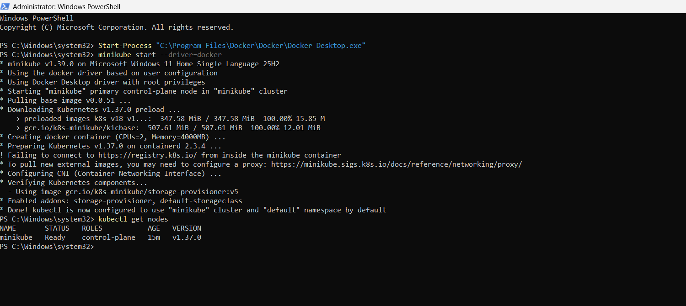
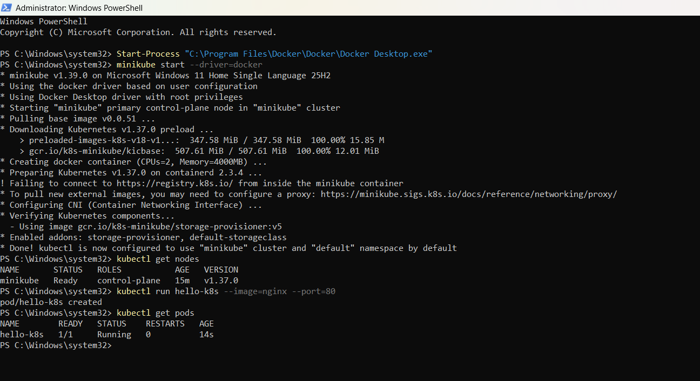
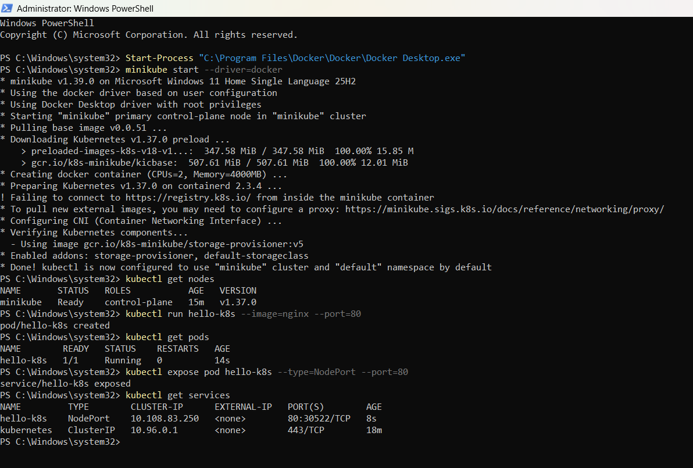
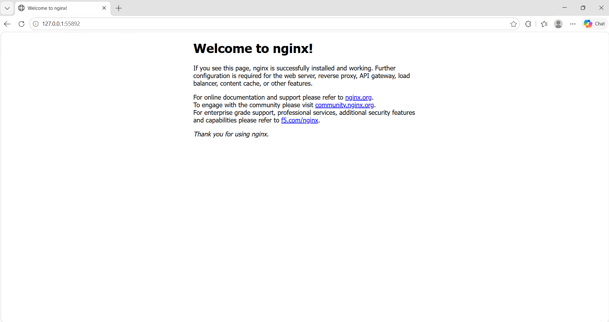

# Exercise 1 — Hello Pod

## Kubernetes Hands-On Exercise Series

This exercise demonstrates how to deploy and expose a containerized web application using Kubernetes and Minikube on Windows 11.

The popular Nginx container image is used to simulate a lightweight Zepto storefront and delivery-status web application. The application is deployed as a Kubernetes Pod and exposed externally using a NodePort Service.

---

## Business Scenario

Imagine working as a DevOps Engineer at Zepto. The product team needs a lightweight web application that displays a storefront and delivery-status page to customers.

The task is to deploy the application on Kubernetes so that it can be accessed through a web browser and managed using Kubernetes resources.

For this hands-on exercise, Nginx is used as a sample web application.

## Objectives

- Set up a local Kubernetes cluster using Minikube.
- Run an Nginx container as a Kubernetes Pod.
- Verify that the Pod is running successfully.
- Expose the Pod using a NodePort Service.
- Access the application through a web browser.
- Understand Kubernetes Pods, Services, and YAML manifests.

---

## Environment

| Component | Configuration |
|---|---|
| Operating System | Windows 11 Home Single Language |
| Container Runtime | Docker Desktop |
| Minikube Driver | Docker |
| Kubernetes Cluster | Minikube |
| Command-Line Tool | kubectl |
| Application Image | nginx |
| Container Port | 80 |
| Service Type | NodePort |
| Code Editor | Visual Studio Code |

---

## Prerequisites

The following tools are required:

- Docker Desktop
- Minikube
- kubectl
- Visual Studio Code (optional)

Docker Desktop must be installed and running before starting Minikube.

### Install kubectl and Minikube

Open PowerShell and run:

```powershell
winget install -e --id Kubernetes.kubectl
winget install -e --id Kubernetes.minikube
```

Verify the installations:

```powershell
docker --version
minikube version
kubectl version --client
```

---

## Step 1 — Start the Minikube Cluster

Start a local Kubernetes cluster using Docker as the driver.

```powershell
minikube start --driver=docker
```

Minikube creates a local Kubernetes environment and configures kubectl to communicate with the cluster.

## Step 2 — Verify the Cluster

Run the following command:

```powershell
kubectl get nodes
```

The Minikube node should reach the `Ready` state, indicating that the cluster is available to schedule workloads.

### Screenshot 1 — Cluster Ready



---

## Step 3 — Create the Nginx Pod

Create a Pod named `hello-k8s` using the Nginx container image.

```powershell
kubectl run hello-k8s --image=nginx --port=80
```

This command creates a Pod containing an Nginx container. Port 80 is declared as the container port.

A Pod is the smallest deployable unit in Kubernetes and can contain one or more containers.

## Step 4 — Verify the Pod

Check the status of the Pod:

```powershell
kubectl get pods
```

Wait until the Pod reaches the `Running` state and the `READY` column shows `1/1`.

Example output:

```text
NAME        READY   STATUS    RESTARTS   AGE
hello-k8s   1/1     Running   0          ...
```

The exact age and other values may differ depending on the environment.

### Screenshot 2 — Pod Running



---

## Step 5 — Expose the Pod Using a NodePort Service

Expose the Pod through a Kubernetes Service:

```powershell
kubectl expose pod hello-k8s --type=NodePort --port=80
```

Verify the Service:

```powershell
kubectl get services
```

Example output:

```text
NAME         TYPE        CLUSTER-IP     EXTERNAL-IP   PORT(S)
hello-k8s    NodePort    10.x.x.x       <none>        80:32xxx/TCP
kubernetes   ClusterIP   10.x.x.x       <none>        443/TCP
```

The NodePort Service exposes the application through a port on the Kubernetes node. Kubernetes automatically assigns a NodePort when one is not specified.

The assigned port and cluster IP may differ between environments.

### Screenshot 3 — Service Created



---

## Step 6 — Access the Application in a Browser

Run the following command:

```powershell
minikube service hello-k8s
```

Minikube provides access to the Service and opens the application in the default browser.

The browser should display the default Nginx welcome page with the message:

**Welcome to nginx!**

This confirms that the Nginx application is reachable through the Kubernetes Service.

### Screenshot 4 — Nginx Welcome Page



---

## Kubernetes Manifests

Kubernetes resources can also be defined declaratively using YAML files. The following manifests represent the Pod and Service used in this exercise.

### 1. pod.yaml

```yaml
apiVersion: v1
kind: Pod
metadata:
  name: hello-k8s
  labels:
    app: hello-k8s
spec:
  containers:
    - name: hello-k8s
      image: nginx
      ports:
        - containerPort: 80
```

**Explanation:**

- `apiVersion: v1` specifies the Kubernetes API version.
- `kind: Pod` defines the resource as a Pod.
- `metadata.name` assigns the name `hello-k8s`.
- `labels` assigns the label used by the Service selector.
- `containers` specifies the container to run.
- `image: nginx` selects the Nginx container image.
- `containerPort: 80` documents the port used by the application.

### 2. service.yaml

```yaml
apiVersion: v1
kind: Service
metadata:
  name: hello-k8s
spec:
  type: NodePort
  selector:
    app: hello-k8s
  ports:
    - port: 80
      targetPort: 80
```

**Explanation:**

- `kind: Service` defines a Kubernetes Service.
- `type: NodePort` exposes the Service through a port on the node.
- `selector` identifies Pods with the label `app: hello-k8s`.
- `port: 80` defines the Service port.
- `targetPort: 80` forwards traffic to port 80 on the selected Pod.

### Apply the YAML Files

The resources can be created declaratively using:

```powershell
kubectl apply -f pod.yaml
kubectl apply -f service.yaml
```

**Note:** The Pod and Service were initially created using `kubectl run` and `kubectl expose`. If those resources already exist, applying the manifests may update them rather than create new ones. Avoid deleting or recreating working resources unnecessarily.

---

## Kubernetes Architecture

The application follows this request flow:

```text
             Web Browser
                  |
                  v
          NodePort Service
             hello-k8s
                  |
                  v
          Kubernetes Pod
             hello-k8s
                  |
                  v
          Nginx Container
              Port 80
```

The Service selects the Pod using its `app: hello-k8s` label and forwards traffic to the application's container port.

---

## Verification Commands

Use the following commands to verify the deployment:

```powershell
kubectl get nodes
kubectl get pods
kubectl get services
kubectl describe pod hello-k8s
kubectl describe service hello-k8s
```

To view the application again:

```powershell
minikube service hello-k8s
```

---

## What This Exercise Demonstrates

### 1. Pods

A Pod is the smallest deployable unit in Kubernetes. In this exercise, the Pod runs a single Nginx container.

### 2. Services

A Service provides a stable way to access an application running in Pods. A NodePort Service allows access through a port on the Kubernetes node.

### 3. Minikube

Minikube provides a local Kubernetes cluster for learning, testing, and development.

### 4. kubectl

kubectl is the command-line tool used to interact with the Kubernetes cluster and manage its resources.

### 5. Declarative Configuration

YAML manifests describe the desired configuration of Kubernetes resources and can be applied using `kubectl apply`.

---

## Repository Structure

```text
Exercise-1-Hello-Pod/
├── README.md
├── pod.yaml
├── service.yaml
└── screenshots/
    ├── 01-cluster-ready.png
    ├── 02-pod-running.png
    ├── 03-service.png
    └── 04-nginx-browser.png
```

---

## Result

The Nginx application was successfully deployed as a Kubernetes Pod, verified in the Running state, exposed through a NodePort Service, and accessed through a web browser.

This exercise demonstrates the basic Kubernetes deployment and networking workflow and provides a foundation for future exercises involving Deployments, ReplicaSets, scaling, self-healing, and Ingress.

